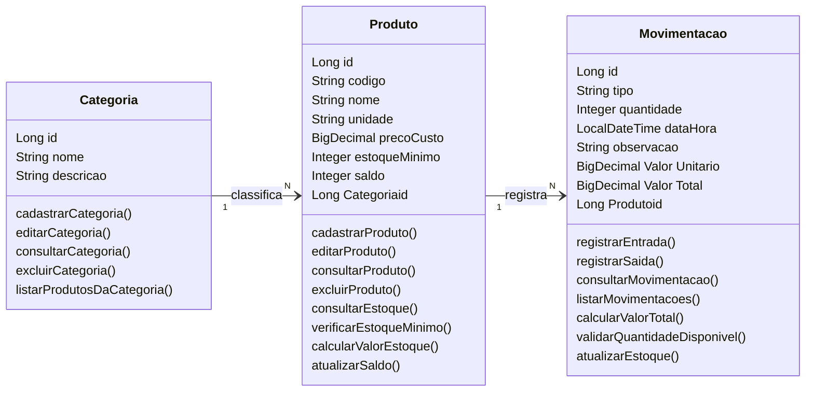

# Controle de Estoque - Fazenda Agropecuária

> Substitua o título acima pelo nome do seu sistema e preencha cada seção deste documento.
> Este README é o **documento de visão** do projeto (entrega **AVA 1**) e, ao longo do curso,
> também será o manual técnico de como executar o sistema.

| | |
|---|---|
| **Aluno(a)** | Rodrigo Correia Bim |
| **Turma** |TEC-N-001788/2026 |
| **Opção escolhida** |controle de estoque|
| **Versão atual** | 0.1.0 |

---

## 1. Visão geral

- **Cadastro e entrada de produtos:** O administrador ou responsável pelo estoque cadastra os produtos agropecuários, como rações, sal mineral, medicamentos veterinários, vacinas, sementes, ferramentas e materiais de manutenção. Ao receber novas mercadorias, registra a entrada e o sistema atualiza automaticamente as quantidades disponíveis.

- **Registro de saídas e consumo:** O funcionário ou responsável pela fazenda registra a retirada de produtos para uso nas atividades agropecuárias, como alimentação do gado, vacinação dos animais, aplicação de medicamentos e manutenção das instalações. O sistema reduz automaticamente o saldo dos produtos retirados.

- **Alertas de estoque mínimo e validade:** Quando um produto atinge a quantidade mínima definida ou está próximo do vencimento, o sistema alerta o responsável para providenciar a reposição ou verificar a validade dos produtos, evitando desperdícios e falta de materiais.

- **Painel de indicadores e relatórios:** O administrador acompanha a quantidade de produtos disponíveis, as entradas e saídas, os produtos mais consumidos, os itens com estoque baixo, os produtos próximos do vencimento e os custos de aquisição dos insumos utilizados na fazenda.

### 1.1 Problema
<!-- Que problema o sistema resolve? Quem sofre com esse problema hoje e como ele é resolvido (planilha, papel, WhatsApp...)? 3 a 5 linhas. -->

O gerenciamento do estoque de uma fazenda agropecuária é frequentemente realizado de forma manual, dificultando o controle das entradas e saídas de produtos utilizados nas atividades rurais. A falta de informações atualizadas pode causar falta de ração, sal mineral, medicamentos veterinários e outros insumos, além de perdas por vencimento e divergências nas quantidades disponíveis. Também se torna difícil acompanhar os custos e identificar quais produtos precisam ser repostos.

### 1.2 Canvas do projeto

| Bloco | Resposta |
|---|---|
| **Usuários** (quem usa o sistema) | Administrador da fazenda (gerencia usuários, produtos e relatórios); estoquista ou funcionário responsável (registra entradas, saídas e consultas); gerente ou proprietário rural (acompanha os custos, o consumo e os níveis de estoque).|
| **Problema** (dor atual) |O estoque de produtos agropecuários é controlado manualmente por planilhas, cadernos ou anotações. Isso dificulta acompanhar a quantidade de rações, sal mineral, medicamentos veterinários, vacinas, sementes, fertilizantes, ferramentas e peças de máquinas. Também podem ocorrer perdas por vencimento, falta de insumos e divergências nas quantidades registradas.|
| **Proposta de valor** (o que melhora com o sistema) |Controlar o estoque de produtos em um único sistema, registrar entradas e saídas, acompanhar os custos dos insumos, identificar produtos com estoque baixo ou próximos do vencimento e facilitar o planejamento das compras e do consumo na fazenda.|
| **Funcionalidades principais** |Cadastro de produtos e categorias; cadastro de fornecedores; registro de entrada de mercadorias e notas fiscais; registro de saídas para consumo na fazenda; atualização automática do saldo; controle de estoque mínimo; registro de lotes e validade de produtos; consulta ao histórico de movimentações; cadastro e login de usuários; painel de indicadores e geração de relatórios de estoque e custos.|
| **Informações que o sistema guarda** |Produtos: código, nome, descrição, categoria, unidade de medida, preço de custo, quantidade disponível e estoque mínimo. Fornecedores: nome, CNPJ ou CPF, telefone e e-mail. Movimentações: produto, tipo de movimentação (entrada ou saída), quantidade, data, responsável e observação. Lotes: número do lote, data de validade e quantidade, quando aplicável. Usuários: nome, login, senha protegida e perfil de acesso.|
| **Indicadores** (o que o gestor quer acompanhar) |Quantidade total de produtos cadastrados; saldo disponível por produto; entradas e saídas por período; produtos com estoque baixo ou zerado; produtos próximos do vencimento; consumo de ração e sal mineral; custo dos insumos utilizados; produtos mais consumidos; valor estimado do estoque e histórico de movimentações.|
| **Restrições** (prazo, tecnologia, equipe) | Projeto individual · Java 21 · Spring Boot 4 · entrega v1.0 em 11/11 |

---

## 2. Requisitos

O sistema de Controle de Estoque de uma Fazenda Agropecuária tem como objetivo facilitar o gerenciamento de insumos agrícolas, rações, medicamentos veterinários, ferramentas, máquinas e demais materiais utilizados nas atividades rurais, permitindo o registro de entradas e saídas de produtos, o acompanhamento das quantidades disponíveis, o controle de validade dos produtos e o monitoramento dos custos, contribuindo para uma gestão mais eficiente da propriedade rural.

### 2.1 Requisitos funcionais (o que o sistema FAZ)

| ID | Requisito | Nível |
|---|---|---|
| RF01 |O sistema deve permitir cadastrar, consultar e editar produtos e insumos da fazenda agropecuária, incluindo nome, código, categoria, quantidade, unidade de medida e preço. | Essencial |
| RF02 |O sistema deve permitir registrar entradas e saídas de produtos, como rações, sementes, fertilizantes, defensivos agrícolas, medicamentos veterinários e ferramentas, informando as quantidades e as datas das movimentações. | Essencial |
| RF03 |O sistema deve atualizar automaticamente o estoque após cada entrada ou saída de produtos, mantendo o registro das movimentações realizadas. | Essencial |
| RF04 | O sistema deve permitir consultar os produtos disponíveis em estoque e identificar aqueles com quantidade baixa ou prazo de validade próximo do vencimento. | Essencial |
| RF05 | O sistema deve gerar relatórios com a quantidade de produtos em estoque, movimentações realizadas, custos dos insumos e produtos que precisam ser repostos. | Importante |

### 2.2 Requisitos não funcionais (COMO o sistema deve ser)

| ID | Requisito |
|---|---|
| RNF01 | O sistema deve ser acessado pelo navegador (aplicação web), permitindo o controle do estoque de produtos e insumos da fazenda agropecuária. |
| RNF02 | O sistema deve exigir login e senha para acesso, garantindo que somente usuários autorizados possam utilizar o sistema. |
| RNF03 | O sistema deve proteger os dados da fazenda, armazenando senhas de forma segura e restringindo o acesso às informações conforme as permissões dos usuários. |
| RNF04 | O sistema deve possuir uma interface simples, intuitiva e fácil de utilizar, facilitando o cadastro e a consulta de produtos agrícolas, rações, medicamentos veterinários, ferramentas e outros insumos. |
| RNF05 | O sistema deve permitir a realização de cópias de segurança periódicas para evitar a perda de informações sobre produtos, estoque e movimentações. |
| RNF06 | O sistema deve processar consultas, cadastros e registros de entradas e saídas de produtos rapidamente, mesmo com grande quantidade de itens cadastrados. |
| RNF07 | O sistema deve garantir que as informações de estoque e as movimentações de entrada e saída sejam registradas corretamente, mantendo os dados atualizados e evitando inconsistências nas quantidades disponíveis. |

### 2.3 Regras de negócio (as REGRAS do negócio que o sistema precisa respeitar)

| ID | Regra |
|---|---|
| RN01 | Cada produto ou insumo da fazenda deve possuir um código exclusivo para evitar duplicidade de cadastro. |
| RN02 | O sistema não deve permitir saídas de produtos em quantidades superiores ao estoque disponível, evitando falta de controle dos materiais da fazenda. |
| RN03 | Após o registro de uma entrada ou saída de produtos, o sistema deve atualizar automaticamente a quantidade disponível em estoque. |
| RN04 | As quantidades e os preços dos produtos não podem ser negativos, e o valor total do estoque deve ser calculado automaticamente com base nas quantidades e nos preços cadastrados. |
| RN05 | Toda entrada ou saída de produtos deve ser registrada com data, quantidade, responsável e motivo da movimentação, como compra, consumo na lavoura, alimentação dos animais ou aplicação veterinária. |
| RN06 | O sistema deve alertar o responsável quando um produto estiver abaixo da quantidade mínima definida ou próximo do vencimento. |
| RN07 | Produtos vencidos não devem ser disponibilizados para uso, especialmente medicamentos veterinários, vacinas e defensivos agrícolas. |
| RN08 | O acesso às funções de cadastro e movimentação do estoque deve ser permitido somente aos usuários autorizados. |

---

## 3. Histórias de usuário

Formato: **Como** *[papel]*, **quero** *[ação]*, **para** *[benefício]*.

**HU01 —** Cadastro de produtos

Como responsável pelo estoque da fazenda agropecuária, quero cadastrar produtos e insumos, para manter o controle dos materiais utilizados na propriedade.
- Critério de aceite: O sistema deve permitir cadastrar produtos com nome, código, categoria e quantidade.
- Critério de aceite: O sistema não deve permitir o cadastro de produtos com códigos duplicados.

**HU02 —** Controle de entrada e saída

Como responsável pelo estoque, quero registrar as entradas e saídas de produtos, para manter as quantidades disponíveis sempre atualizadas.
- Critério de aceite: O sistema deve atualizar automaticamente o estoque após cada movimentação.
- Critério de aceite: O sistema não deve permitir saídas em quantidades superiores ao estoque disponível.

**HU03 —** Consulta de estoque

Como proprietário da fazenda, quero consultar os produtos disponíveis em estoque, para identificar os materiais que precisam ser comprados.
- Critério de aceite: O sistema deve exibir a quantidade disponível de cada produto.
- Critério de aceite: O sistema deve alertar quando um produto estiver abaixo da quantidade mínima definida.

**HU04 —** Controle de validade

Como responsável pelo estoque, quero acompanhar a validade dos produtos, para evitar o uso de medicamentos veterinários e insumos vencidos.
- Critério de aceite: O sistema deve permitir registrar a data de validade dos produtos.
- Critério de aceite: O sistema deve alertar sobre produtos próximos do vencimento.

**HU05 —** Relatórios de estoque

Como proprietário da fazenda, quero gerar relatórios das movimentações e dos produtos em estoque, para acompanhar os custos e melhorar a gestão da propriedade.
- Critério de aceite: O sistema deve apresentar relatórios de entradas, saídas e quantidades disponíveis.
- Critério de aceite: O sistema deve permitir identificar os produtos com maior consumo e aqueles que precisam de reposição.

---

## 4. Modelo de dados



---

## 5. Como executar

### No GitHub Codespaces (recomendado)
1. No repositório, clique em **Code → Codespaces → Create codespace on main** (ou abra o Codespace existente).
2. Aguarde a preparação do ambiente.
3. No terminal, execute:
   ```bash
   mvn spring-boot:run
   ```
4. Quando aparecer o aviso da porta **8080**, clique em **Abrir no navegador**.

### No computador (ferramentas instaladas)
Requisitos: JDK 21 e uma IDE (IntelliJ IDEA ou VS Code com o *Extension Pack for Java*).
Abra o projeto na IDE e execute a classe `SistemaApplication`. Acesse `http://localhost:8080`.

### Acesso
| Usuário | Senha | Perfil |
|---|---|---|
| admin | admin123 | Administrador |
| operador | operador123 | Operador |

*(o login passa a ser exigido a partir do Encontro 7)*

---

## 6. Tecnologias
Java 21 · Spring Boot 4 · Spring MVC · Thymeleaf · Bootstrap 5 · Spring Data JPA · H2 (desenvolvimento) · MySQL (produção) · Spring Security · Git/GitHub

## 7. Uso de inteligência artificial
<!-- Registre aqui, de forma resumida, quando e como você usou ferramentas de IA de forma relevante no projeto. -->

## 8. Histórico de versões
| Versão | Data | Descrição |
|---|---|---|
| 0.1.0 | | Projeto inicial criado a partir do repositório modelo |
